# 03 · Data Model

Postgres. A design-level spec, not DDL. PK type follows the existing convention (assumed `bigint`, Q-11).

Green means a new table, blue means an existing table with new columns, and grey means unchanged.

## 1. Principles

1. **Additive.** New tables and new nullable columns. No existing column changes meaning, and no historical row is rewritten.
2. **Used definitions are immutable.** A question definition, a published program version and its question set are never updated once referenced. Change means a new row (02 §2.1).
3. **Rows where there are references, JSON where there are parameters.** Questions and question sets are rows with FKs because answers reference them and they grow. Rate overrides and discounts are a JSON column validated against the rater manifest.
4. **Published means immutable**, enforced in the service layer, a DB trigger, constraints and hashes (§5).
5. **Public IDs** (`prg_…`, `prv_…`, `app_…`), prefixed and time-sortable, on anything exposed by an API. Sequential PKs are never exposed.
6. **`row_version`** on mutable API resources backs `ETag` / `If-Match`.

## 2. Relationships

| From | To | Cardinality | FK |
|---|---|---|---|
| partner | api_client | 1 → 0..* | `api_client.partner_id` |
| partner | program | 1 → 0..* | `program.partner_id` (null = base program) |
| program (base) | program (partner) | 1 → 0..* | `program.base_program_id` |
| program | program_version | 1 → 1..* | `program_version.program_id` |
| rating_engine_version | program_version | 1 → 0..* | `program_version.rating_engine_version_id` |
| program_version (base) | program_version (partner) | 1 → 0..* | `program_version.base_program_version_id` |
| program_version | program_version | 1 → 0..* | `based_on_version_id`, `restored_from_version_id` |
| program_version | program_version_question | 1 → 0..* | composite (`program_version_id`, `rating_engine_version_id`) |
| application_question | program_version_question | 1 → 0..* | composite (`question_id`, `rating_engine_version_id`), so the question must belong to the version's own rater |
| rating_engine_version | application_question | 1 → 0..* | `application_question.rating_engine_version_id` (existing, NOT NULL, unchanged) |
| application_question | application_question | 0..1 → 0..* | `carried_from_question_id` (lineage across rater versions) |
| program_version | application | 1 → 0..* | `application.program_version_id` |
| rating_engine_version | application | 1 → 0..* | `application.rating_engine_version_id`, must equal the program version's (composite FK) |
| partner | application | 0..1 → 0..* | `application.partner_id` |
| company | application | 1 → 0..* | `application.company_id` (existing) |
| application | application_answer | 1 → 0..* | existing |
| application_question | application_answer | 1 → 0..* | existing |
| application | application_coverage | 1 → 0..* | existing |
| application_coverage | application_discount | 1 → 0..* | `application_discount.application_coverage_id` |
| application | rating_run | 1 → 0..* | `rating_run.application_id` |
| rating_run | application_coverage | 0..1 → 0..* | `application_coverage.rating_run_id` |
| program | rating_test_case | 0..1 → 0..* | `rating_test_case.program_id` (null = all programs) |
| program_version | backtest_run | 0..1 → 0..* | `backtest_run.program_version_id` |
| api_client | idempotency_key | 1 → 0..* | `idempotency_key.api_client_id` |

### How the question tables fit together

### Where `rating_engine_version_id` appears, and why

| Table | Role | Keep? |
|---|---|---|
| `application_question` | Owner: which edition (rater version) a definition belongs to | Yes (existing, NOT NULL) |
| `program_version` | **The pin, the source of truth** | Yes |
| `program_version_question` | Constraint carrier: lets two composite FKs refuse a question from another edition. Can't drift, because both FKs force it to equal the program version's rater. | Yes. The alternative is a trigger. |
| `application` | Existing column read by current Django code. A composite FK forces it to equal the program version's rater. | Keep for compatibility; could be dropped once all code reads through `program_version` |
| `rating_run` | Fact of what actually ran. Must not depend on mutable pointers (a draft's rater, an application moved to a newer version). | Yes |
| `backtest_run` | Rater under test, often with no program version (a DS pull request) | Yes |

`application_answer` doesn't get the column (a hot existing table). A `BEFORE INSERT OR UPDATE` trigger checks that the answer's question belongs to the application's rater version instead.

## 3. New tables

### `partner`
| Column | Type | Notes |
|---|---|---|
| id | bigint **PK** | |
| public_id | text **UK** | `ptr_…` |
| code | text **UK** | immutable slug |
| name | text | |
| status | enum `onboarding`, `active`, `paused`, `terminated` | non-active returns 403 on the external API |
| created_at, updated_at | timestamptz | |

### `api_client`
| Column | Type | Notes |
|---|---|---|
| id | bigint **PK** | |
| public_id | text **UK** | |
| partner_id | **FK** → partner | |
| environment | enum `sandbox`, `production` | |
| cognito_client_id | text **UK** | Cognito holds the secret, we never store it |
| usage_plan_id | text | API Gateway throttling tier |
| scopes | text[] | e.g. `applications:write` |
| created_at, last_used_at, revoked_at | timestamptz | rotation = new client, then revoke old |

### `program`
| Column | Type | Notes |
|---|---|---|
| id | bigint **PK** | |
| public_id | text **UK** | `prg_…` |
| code | text **UK** | |
| name | text | |
| partner_id | **FK** → partner, null | null = base program |
| base_program_id | **FK** → program, null | required for partner programs |
| base_upgrade_policy | enum `follow_base`, `manual` | 02 §8 |
| status | enum `active`, `suspended`, `retired` | |
| constraint | `CHECK ((partner_id IS NULL) = (base_program_id IS NULL))` | |

### `program_version`
| Column | Type | Notes |
|---|---|---|
| id | bigint **PK** | |
| public_id | text **UK** | `prv_…` |
| program_id | **FK** → program | |
| version_no | int, null | assigned at publish. **UK** (program_id, version_no) |
| status | enum `draft`, `in_review`, `approved`, `published`, `superseded` | |
| rating_engine_version_id | **FK** → rating_engine_version | pinned rater |
| base_program_version_id | **FK** → program_version, null | partner programs only, must point at a published base version |
| based_on_version_id | **FK** → program_version, null | head when the draft started; publish requires it is still head |
| restored_from_version_id | **FK** → program_version, null | set when the draft is a restore |
| config | jsonb not null default `{}` | `rating`, `discounts` (02 §5) |
| config_schema_version | text | |
| content_hash | char(64) | SHA-256 of the canonical resolved version (questions, config, rater id, base id) |
| effective_from, effective_to | timestamptz, null | set at publish |
| backtest_run_id | **FK** → backtest_run, null | required if pricing changed |
| filing_ref | text, null | admitted products (Q-01) |
| change_note | text | |
| created_by, submitted_by, approved_by | user FK | `CHECK (approved_by <> created_by)` |
| created_at, approved_at, published_at | timestamptz | |
| row_version | int | ETag while draft |
| unique | (id, rating_engine_version_id) | target of the composite FK from `application` |
| partial unique | (program_id) WHERE status IN (`draft`, `in_review`, `approved`) | one open draft per program |
| exclusion | `EXCLUDE USING gist (program_id WITH =, tstzrange(effective_from, effective_to) WITH &&) WHERE (status IN ('published','superseded'))` | no overlapping windows; needs `btree_gist` |

### `program_version_question`
| Column | Type | Notes |
|---|---|---|
| id | bigint **PK** | |
| program_version_id | **FK** → program_version | |
| question_id | **FK** → application_question | |
| rating_engine_version_id | **FK** → rating_engine_version | equals the program version's rater; composite FKs (program_version_id, rating_engine_version_id) → program_version (id, rating_engine_version_id) and (question_id, rating_engine_version_id) → application_question (id, rating_engine_version_id) |
| mode | enum `ask`, `preset`, `omit` | `omit` only in partner versions |
| preset_value | text, null | `CHECK ((mode = 'preset') = (preset_value IS NOT NULL))`; validated against the definition's type and options |
| required | bool, null | null = inherit (partner rows) |
| label, help_text | text, null | exact wording shown, snapshotted per version; null = inherit (partner rows) |
| option_labels | jsonb, null | `{code: label}` shown for this version; null = default labels from the definition |
| section, display_order | text, int, null | presentation for our UI |
| allowed_options | text[], null | must be a subset of the question's options |
| visibility | jsonb, null | structured show-if, e.g. `{"all":[{"key":"industry","op":"eq","value":"other"}]}` |
| unique | (program_version_id, question_id) | |
| rule | partner rows overlay base rows only when the partner version's rater equals its base version's rater; otherwise the set is complete | |

### `rating_run`
| Column | Type | Notes |
|---|---|---|
| id | bigint **PK** | |
| application_id | **FK** → application | |
| program_version_id | **FK** → program_version, null | null only for history before backfill |
| rating_engine_version_id | **FK** → rating_engine_version | |
| mode | enum `live`, `preview` | preview never sets a premium |
| request, response | jsonb | exact payloads |
| outcome | enum `ok`, `declined`, `input_error`, `rater_error`, `timeout` | |
| answers_hash | char(64) | stale-quote detection: compared with current answers |
| duration_ms | int | |
| requested_by_user, requested_by_client | FK, null | |
| request_id | text | log correlation |
| created_at | timestamptz | partition key if volume warrants |

### `application_discount`
| Column | Type | Notes |
|---|---|---|
| id | bigint **PK** | |
| application_coverage_id | **FK** → application_coverage | |
| discount_code | text | validated against the manifest and program config |
| value | numeric(9,6) | within limits |
| source | enum `underwriter`, `program`, `partner` | |
| applied_by | user FK, null | |
| reason | text | |
| unique | (application_coverage_id, discount_code) | |

### `rating_test_case`
| Column | Type | Notes |
|---|---|---|
| id | bigint **PK** | |
| program_id | **FK** → program, null | null = runs for every program |
| name | text | "restaurant, high liquor sales" |
| answers, coverages | jsonb | a synthetic application |
| expected | jsonb | exact premium or a range per coverage |
| created_by, created_at | | |

### `backtest_run`
| Column | Type | Notes |
|---|---|---|
| id | bigint **PK** | |
| program_version_id | **FK** → program_version, null | candidate config |
| rating_engine_version_id | **FK** → rating_engine_version | rater under test |
| baseline | jsonb | `{type: program_version \| rater_version \| expected_file, ref}` |
| corpus_uri, corpus_hash | text | replay set snapshot |
| status | enum `queued`, `running`, `passed`, `failed`, `needs_ack` | |
| summary | jsonb | rated, changed, % change histogram, max diff, new declines, errors |
| thresholds_breached | bool | requires a DS approver |
| report_uri | text | |
| acknowledged_by | user FK, null | |

### `idempotency_key`
**PK** (api_client_id, key) · api_client_id **FK** → api_client · request_hash · status_code · response_body · resource_public_id · created_at · expires_at (24h). Internal callers use a nullable `user_id` with a partial unique index.

## 4. Existing tables: new columns

### `application`
| Add | Notes |
|---|---|
| program_version_id **FK** | NOT NULL after backfill |
| composite **FK** (program_version_id, rating_engine_version_id) → program_version (id, rating_engine_version_id) | the existing rater column can never disagree with the program version |
| partner_id **FK** → partner, null | tenancy scoping and indexing; service layer keeps it equal to the program's partner |
| channel | enum `underwriter_ui`, `partner_api`, `direct` |
| external_ref | partner's id; **UK** (partner_id, external_ref) |
| public_id **UK** | backfilled |
| row_version | ETag |

### `application_question` (question definitions, still per rater version)
| Change | Notes |
|---|---|
| rating_engine_version_id | **Unchanged**: existing FK, stays NOT NULL |
| rating_engine_question_key | the key the rater reads (to confirm against `rating_engine_key`, Q-21) |
| **UK** (rating_engine_version_id, rating_engine_question_key) | one definition per key per rater version. Inspect existing data for duplicates before adding it. |
| **UK** (id, rating_engine_version_id) | target of the composite FK from `program_version_question` |
| answer_type | enum `text`, `integer`, `decimal`, `money`, `boolean`, `enum`, `date` |
| options | jsonb `[{code, label}]`; default labels, which a program version can override |
| validation | jsonb: min, max, pattern, max_length |
| purpose | enum `rating_input`, `underwriting`, `informational` |
| carried_from_question_id | **FK** → application_question, null; lineage when copied to a new rater version |
| created_at, created_by | |
| immutability | trigger rejects UPDATE and DELETE once a published question set or any answer references the row |

`question_text` and `help_text` stay as the default wording that's copied into a question set when a question is added. What an applicant actually saw is the snapshot on `program_version_question`.

### `application_answer`
| Add | Notes |
|---|---|
| source | enum `applicant`, `partner_api`, `preset`, `underwriter` |
| updated_at, updated_by | |
| **UK** (application_id, question_id) | one answer per question, updated in place |

`answer_text` remains the storage. New writes are validated against the question's type and stored in canonical form.

### `application_coverage`
`rating_run_id` **FK** → rating_run. Verify that money columns are `numeric` (Q-11).

### `rating_engine_version`
`manifest` jsonb (generated, immutable per version) · `status` enum `registered`, `active`, `deprecated`, `retired` · `code_ref` (git SHA). `endpoint_url` must be a published, numbered Lambda version. Rater versions are never deleted. `retired` means closed to new program versions only. The Lambda version and its build artifact stay callable for replay for the full record-retention period.

## 5. Version history mechanics

| Action | What happens |
|---|---|
| Start a draft | Copy head's question-set rows and config into a new `draft` row with `based_on_version_id = head` |
| Move to a new rater | Draft pins the new rater; question-set rows re-pointed by key to that rater's carried-forward definitions; changed definitions shown in the diff |
| Edit | Autosave on the draft (`If-Match`); validated against the JSON Schema on save |
| Diff | Any two versions: question rows joined on `question_id` (added, removed, changed columns), config compared as JSON paths |
| Restore vN | New draft with vN's content, `restored_from_version_id = vN`, `based_on_version_id = head`. Normal checks and approval. |
| Publish | One transaction: verify head is unchanged, assign `version_no`, set `effective_from`, close the previous window, store `content_hash` |

Immutability, in layers:
1. The service layer edits drafts only (409 otherwise).
2. A trigger rejects UPDATE and DELETE on published `program_version` rows (except `effective_to` and the `superseded` status), on their `program_version_question` rows, and on any referenced `application_question` row.
3. The app role has no DELETE on configuration tables.
4. A scheduled job recomputes `content_hash` and alarms on mismatch.
5. Raters are referenced by numbered Lambda versions only.
6. `rating_run` keeps the evidence even if everything above failed.

## 6. Indexes

| Query | Index |
|---|---|
| Version in effect for (program, date) | GiST from the exclusion constraint |
| Question set of a version | **UK** (program_version_id, question_id) |
| Answers for an application | **UK** (application_id, question_id) |
| Partner lists its applications | (partner_id, created_at DESC, id) |
| Latest rating | rating_run (application_id, created_at DESC) |
| Programs behind a base, or on a rater | program_version (base_program_version_id), (rating_engine_version_id) |
| Which versions use question X | program_version_question (question_id) |
| A key across rater versions | application_question (rating_engine_question_key) |

## 7. Migration (online, additive)

1. Add columns as nullable. No existing column is altered.
2. Inspect `rating_engine_version.effective_date` for overlaps (they'd violate the exclusion constraint).
3. Create the base program and one published `program_version` per existing rater version, with windows from the effective dates and question-set rows pointing at that rater version's existing questions.
4. Backfill `application.program_version_id` and `public_id` in batches, then set NOT NULL.
5. Before adding the unique (rating_engine_version_id, rating_engine_question_key), inspect existing rows for duplicate keys within a version and resolve them (Q-21). Existing rows aren't modified: if duplicates exist, the constraint is added `NOT VALID` for history and enforced for new rows.
6. Backfill `answer_type`, `options` and `purpose` on the active rater version's rows only, from its manifest. Older versions stay as they are, used only for replaying history.
7. Capture manifests for active rater versions. Older versions stay manifest-less, used only for replaying history.
