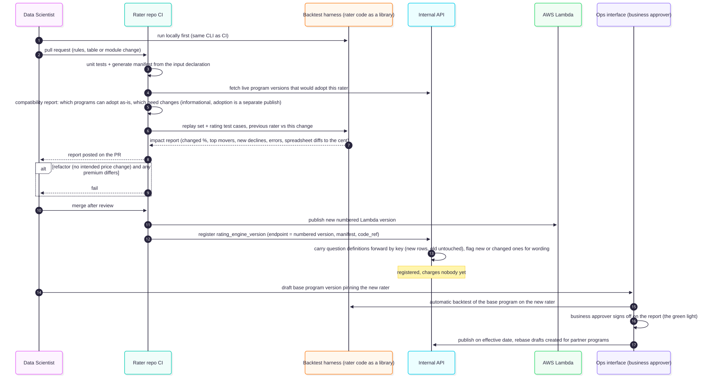

# 05 · Change Workflows and Safety

The goal: changing questions or rates should be simple, and fast for the common cases, and still impossible to get into production without the checks. Everything below runs automatically. People only review and approve.

## 1. The three workflows

### 1.1 Ops: question change (no pricing impact)

Wording, order, help text, show-if rules, or a new underwriting or informational question.

1. Open the program's draft in the Ops interface. It's created from head if none exists.
2. Edit. It autosaves and validates on every save.
3. Preview the form exactly as an applicant or partner will see it.
4. The schema compatibility check runs (04 §4). If the change is breaking for API partners, the effective date must respect the notice period.
5. One approver who isn't the author. Publish.

No backtest, because no rating input or preset changed. This is the same-day loop for question experiments.

### 1.2 Ops: rate, module parameter or discount change

1. Edit an overridable rate value, module parameter or discount in the draft. Limits come from the manifest, and the editor won't accept a value outside them.
2. Automatic checks (§3).
3. Automatic backtest over the replay set and the rating test cases, compared with the current published version. The impact report is attached to the draft.
4. Approver. If impact thresholds are crossed (§2.3), a Data Science approver is also required.
5. Publish on an effective date, with a filing reference for admitted products (Q-01).

### 1.3 Data Science: rater change

1. Run the backtest locally (the same CLI as CI) while working.
2. Open a pull request on the rater repo.
3. CI runs unit tests and generates the manifest from the input declaration.
4. CI produces a compatibility report. It fetches live program versions and lists which could adopt this rater as-is and which use an input, value, table or module it no longer has. It doesn't fail the build, because adopting a rater is a separate, deliberate program publish, and that publish is what blocks an incompatible move.
5. CI runs the backtest of the previous rater against this change. The report is posted on the PR. Refactors must show zero differences. Intended price changes show their impact.
6. Merge. CI publishes a numbered Lambda version and registers the `rating_engine_version` with its manifest. The system carries question definitions forward from the previous version (02 §2.1) and flags new or changed ones for Ops to word. It charges nobody yet.
7. A base program draft pins the new rater, is backtested, and the business approver signs off. That's the green light from the DS workflow, now with an actual report. Publish, and rebase drafts are created for partner programs (02 §8).

## 2. Backtest

### 2.1 What it does

It replays applications through the rater twice, once with the current published version and once with the proposed change, and reports the difference for each application and coverage: count changed, distribution of percentage change, largest movers, new declines, new errors. It runs the rater code as a library, in parallel, never through Lambda, so backtests can't eat production concurrency.

### 2.2 The replay set

- Starts with Data Science's 1,000 applications.
- Grows on its own: every live rating stores its exact request in `rating_run`, so recent real applications are added to the set (sampled by program and segment, and refreshed on a schedule). After a few months it represents current business far better than a fixed set.
- Plus `rating_test_case` rows: hand-written applications with an expected premium or range, for segments with no history (a new program, a new industry).
- Plus spreadsheet expectations: DS upload a CSV of (application, coverage, expected premium), and the harness compares to the cent. That replaces the manual side-by-side review.

### 2.3 Impact thresholds

Defaults, tuned per program with DS:

| Signal | Default | Effect |
|---|---|---|
| Any single premium moves more than | 10% | Flag; DS approver required |
| Program average moves more than | 3% | Flag; DS approver required |
| New declines or errors | any | Flag; DS approver required |
| Affected segment has no replay data and no test case | any | Flag as untested; a test case must be added or the risk acknowledged |

This is how "0.80 typed instead of 0.90" is caught before publish. The change is within limits, but restaurant premiums drop about 11%, which crosses the threshold and pulls in a second, more specialised reviewer. The premium-drift alarm after publish (06) is the last net, for live traffic that differs from history.

### 2.4 The parity rule

When we refactor the rater (making it config-aware, extracting inline factors into tables, converting a partner branch), the refactored rater with no program config must produce exactly the premiums the current rater produces today for the base program. Exact, not close. For a partner branch conversion, the same rule applies to that partner's historical applications through its new partner program. Intentional price changes aren't held to this rule. They produce a report the business approves.

## 3. The validation chain

The rater should never be where we discover a missing input. Each stage blocks a class of problems before the next stage sees them.

| Stage | Checks | Prevents |
|---|---|---|
| Rater build (CI) | Inputs read only through the declaration (tests fail otherwise). Manifest generated. Compatibility report against live programs. | Undeclared inputs; surprises at adoption time |
| Question definitions | Rating-input definitions generated from the manifest at rater registration; key, type and options copied; immutable once referenced | Typos, type or option mismatches, and edits reaching back into history |
| Program publish | (0) The pinned rater has every input, value, table and module the program uses. (1) Every question belongs to the version's own rater (composite FK). (2) Every required rater input is covered by a required, always-visible question or a preset. (3) Presets and `allowed_options` are valid values. (4) Overrides target overridable tables, have the right key shape, and are within limits. (5) Modules exist, parameters are valid, and their `requires_inputs` are covered. (6) Discount codes and limits are valid. (7) Schema compatibility class (04 §4). (8) Backtest attached if pricing changed. | A program that can't be rated, or that breaks partners |
| Answer write | Key in this version's resolved set, correct type, allowed value, within range | Junk stored at all |
| Submit | Every required, visible question answered | Incomplete applications reaching rating |
| Preflight | Payload validated against the manifest's input schema | Anything earlier checks missed |
| Rater | Validates its own input and returns a structured error (`missing_input`, `invalid_value`), never a silent default | A wrong price |

Data that already exists is protected too:
- **Stale quotes.** `rating_run.answers_hash` is compared with the current answers. If an answer changed after rating, the quote is marked stale and must be re-rated before use.
- **Nothing is deleted.** Rater versions, their definitions and program versions are kept and replayable for the full retention period. A quote from three months ago replays on its own rater with its stored payload and gives the identical premium.
- **Immutable definitions.** A question definition can't be updated or deleted once a published version or an answer references it. Wording changes are new program versions, and meaning changes are new rater versions.
- **Pinning.** Applications keep their program version, so a later publish never invalidates their answers or premium.

## 4. Failure modes

| Failure | Noticed by | Behavior |
|---|---|---|
| Preflight fails | `RatingInputErrors` alarm (P2: it means a validation bug) | Quote `needs_attention`, no premium written, `rating_run` records the error |
| Rater error or timeout | Lambda and rating alarms, composite "rating degraded" page | Submit succeeds, quote `pending`, retried with backoff (deterministic, so safe) |
| Valid but wrong config | Impact thresholds before publish; premium-drift alarm after | Restore the previous version as a new one |
| Partner sends junk or retries | Validation metrics per partner; idempotency | 422 with field errors; retries return the original result |
| Two people edit one draft | `If-Match` | Second save gets 412; reload and reapply |
| Two drafts race to publish | Only one open draft per program; head check at publish | Second publish refused |
| Out-of-band DB change to a published version | Trigger blocks it; hash job alarms | Investigate; `rating_run` holds the evidence |
| Log pipeline stops | Firehose delivery alarm | CloudWatch keeps 30 days; re-export the gap |
| Regional outage | Health alarms | Restore in the second US region (07 §3) |
| Regulator asks why a premium was X | n/a | Replay the stored request on the same numbered Lambda version |
