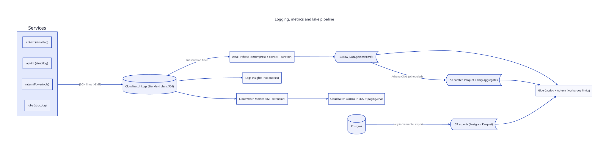

# 06 · Observability

Everything is AWS-native (CloudWatch, Firehose, S3, Athena) or an open-source library (structlog, Powertools for AWS Lambda). No new vendor.

## 1. Principles

1. **Emit once.** Each significant event is one structured JSON log line. Where it carries numbers, it's in CloudWatch Embedded Metric Format (EMF), so the same line produces the metric, the searchable log, and the lake record.
2. **One log schema** across services, enforced by a small shared logging package.
3. **Logs aren't a ledger.** Business counts come from a Postgres export. Logs can drop or duplicate events.
4. **Bounded metric dimensions:** Service, Environment, Endpoint, Outcome, Partner, Program, Coverage. Application and company ids go in log fields, never in dimensions.
5. **No PII in logs.** Answer keys and error codes are logged, answer values never.
6. **Publishes are events**, shown as dashboard annotations.

## 2. Logging

| Runtime | Library | Context bound per request |
|---|---|---|
| Django (`api-ext`, `api-int`, `ops-jobs`) | structlog with a JSON renderer, wrapping stdlib logging | request_id, trace_id, principal, partner_code, program_code, program_version_id, application_id |
| Rater Lambdas | Powertools Logger and Metrics | request_id from the payload, rater version |

Every line has `ts`, `level`, `service`, `env`, `version` (git SHA), `event`, `request_id`, plus context and outcome fields (`outcome`, `error_code`, `http_status`, `duration_ms`).

Event catalog (initial): `api.request.completed`, `partner.application.created | validation_failed | submitted`, `rating.preflight_failed`, `rating.requested | completed | failed`, `program_version.validated | backtest_completed | published | rejected`, `rebase.drafts_created`, `schema.breaking_change_scheduled`, `auth.failed`, `idempotency.replayed | conflict`, `export.completed`.

## 3. Where metrics live

| Store | Used for |
|---|---|
| CloudWatch Metrics (from EMF) | Real-time alarms and dashboards |
| S3 log lake → Athena | Long-term behavior and usage analytics, re-aggregated later |
| Daily Postgres export → S3 → Athena | Business KPIs (submissions, quotes, premiums) joined with behavior |

No separate metrics database.

## 4. Log lake

CloudWatch Logs (Standard class, 30-day retention) → subscription filter → Firehose (built-in decompression and message extraction, partitioned by service and date) → S3 raw JSON → scheduled Athena CTAS jobs compact to Parquet and daily aggregates. Glue Catalog, and Athena workgroups with per-query scan limits.

Gotchas: log groups must be **Standard** class (Infrequent Access doesn't support subscription filters or EMF, and the class can't be changed later). Land raw JSON first, because Firehose's own Parquet conversion drops fields outside a fixed schema. EMF extraction on ECS or EC2 depends on the log driver or agent, so verify it on the actual hosting in phase 0.

## 5. Metrics (namespace `InsureNext/Platform`)

| Metric | Dimensions |
|---|---|
| `ApiRequests`, `ApiLatency` | Service, Endpoint, StatusClass |
| `PartnerSubmissions` | Partner, Program, Outcome |
| `PartnerValidationFailures` | Partner, Program |
| `RatingRequests`, `RatingLatency` | Program, Outcome |
| `RatingInputErrors` (preflight failures) | Program |
| `PremiumAmount` (percentiles), `DiscountRatio`, `Declines` | Program, Coverage |
| `ConfigPublishes`, `PublishWithoutBacktest`, `StaleQuotes` | Program |
| `AuthFailures`, `IdempotencyConflicts` | Partner |

Plus AWS-native metrics: API Gateway, Lambda, RDS, Firehose, WAF.

## 6. Alarms

Thresholds are starting proposals, recalibrated after the phase 0 baseline. Each alarm goes to an SNS topic per severity, then paging or chat. All alarms are defined in IaC.

| # | Alarm | Condition | Sev |
|---|---|---|---|
| 1 | External API 5xx rate | > 1% for 3 × 5 min | P1 |
| 2 | External API p99 latency | > 2× baseline for 3 × 5 min | P2 |
| 3 | Internal API 5xx rate | > 2% for 3 × 5 min | P2 |
| 4 | Rater error rate | > 1% for 3 × 5 min | P1 |
| 5 | Rater throttles | > 0 for 5 min | P1 |
| 6 | Rater duration near timeout | p99 > 80% of timeout | P2 |
| 7 | **Rating degraded** (composite of 4, 5, rating failures) | any | P1, single page |
| 8 | **Preflight failure** | `RatingInputErrors` > 0 | P2: a validation bug |
| 9 | Partner validation spike | anomaly band, 3 × 15 min, per partner | P3 → Partner Growth |
| 10 | Partner silent | 0 submissions over N hours, per active partner | P3 → Partner Growth |
| 11 | Premium drift | `PremiumAmount` p50 anomaly per program, 2 × 1 h | P3 → DS and Ops |
| 12 | Publish without backtest | > 0 | P1 (should be impossible) |
| 13 | Content hash mismatch | > 0 | P1 |
| 14 | Auth failure spike | > 5× baseline over 15 min | P2 |
| 15 | Partner throttled | 429s > 5% of a partner's requests for 15 min | P3 → Partner Growth |
| 16 | RDS CPU / storage / connections | > 80% / < 15% free / > 80% of max | P1–P2 |
| 17 | Lake delivery failure | Firehose success < 1 for 15 min | P3 |
| 18 | Logs silent | no incoming events for 15 min (prod) | P2 |
| 19 | Export failed | > 0 | P3 |

Per-partner alarms (9, 10, 15) are created by IaC from the active partner list.

## 7. Dashboards and reports

Dashboards: platform overview, rating (per program, with publish markers), partner health, config timeline (publishes, backtests, programs behind base), data platform, database.

Reports (Athena): a weekly partner report (submissions, acceptance rate, top failing fields, time to quote), and a monthly pricing report (publishes, backtest versus live drift, overrides and discounts per program).
