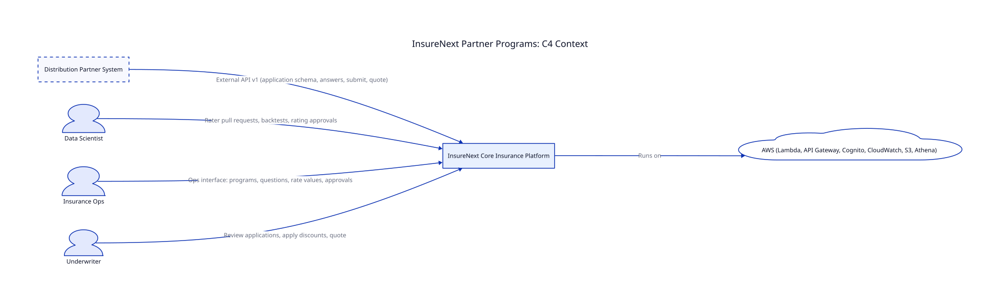
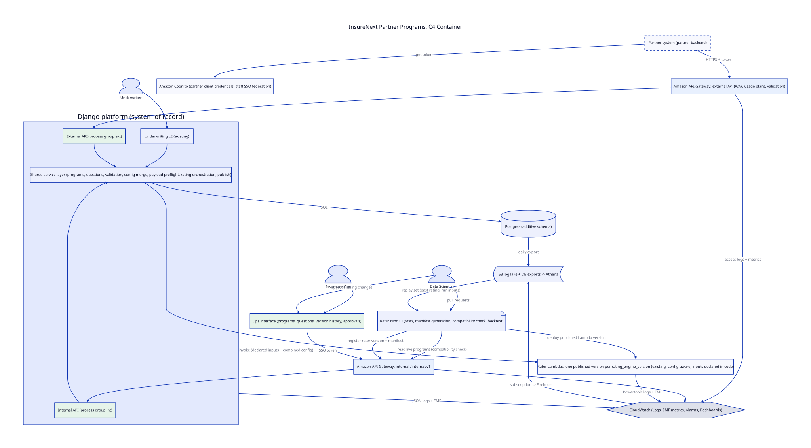

# 07 · Infrastructure

## 1. Stack

| Component | Choice | Change |
|---|---|---|
| System of record, service layer, both APIs, Ops interface backend | Django + Postgres (existing) | Extended |
| API framework | Whatever the codebase uses; otherwise Django Ninja (or DRF with drf-spectacular if DRF exists) | |
| Contract tooling | OpenAPI 3.1, Spectral, oasdiff | New, in CI |
| Front door | Amazon API Gateway (REST type), WAF on the external one | New |
| Identity | Amazon Cognito: partner client credentials, staff SSO federated from the company IdP | New |
| Schema validation | `jsonschema`, validators compiled once per program version | New |
| Rating | Existing rater Lambdas, refactored once | Extended |
| Backtest harness | The rater's own language, the rater code as a library, run in CI and locally | New |
| Ops interface | React + TypeScript SPA on the internal API with a generated client; Django templates + HTMX if there's no frontend capacity (Q-13) | New |
| Logging and metrics | structlog, Powertools, EMF | New |
| Log lake | CloudWatch → Firehose → S3 → Glue → Athena | New |
| IaC | Whatever exists; Terraform or OpenTofu if nothing | |

Not added: a new language runtime, Kafka, Redis, Kubernetes, a metrics database, a third-party gateway. Each would be ongoing cost without a requirement behind it.

## 2. API Gateway

All of this is available as AWS-managed services. The gateway is Amazon API Gateway, not a separate product to run.

| Responsibility | Where |
|---|---|
| Token and scope validation | Gateway (Cognito authorizer); Django re-checks claims and enforces tenancy |
| Per-partner throttling and quotas | Gateway usage plans; each partner's client mapped to a plan |
| Coarse request validation | Gateway validators generated from OpenAPI; full validation in Django against the program schema |
| Access logs | Gateway JSON access logs → CloudWatch → lake |
| Edge protection | WAF on the external gateway |
| Design standards | CI (Spectral, oasdiff) before a spec is deployed to the gateway |
| Routing | A backend can be split out later without changing partner URLs |

**REST type, not HTTP type:** only the REST type has usage plans with per-client throttling and built-in request validation, which are the reasons for having a gateway here.

To verify at build time: the 29-second default integration timeout (rating must stay well under it), the 10 MB payload limit, private integration wiring to Django's load balancer (historically a Network Load Balancer through VPC Link), and per-request pricing. Internal gateway exposure (private API vs regional with a WAF allow-list) depends on how staff reach internal tools (Q-14).

## 3. Region, backups and DR

| Data | Protection |
|---|---|
| Postgres | Multi-AZ; automated backups with point-in-time restore; backups copied to a second US region |
| Rater code for every version in use | Numbered Lambda versions, plus build artifacts in a versioned S3 bucket replicated to the second region |
| IaC, API specs, code | Git |
| Secrets | Secrets Manager replication |
| Log lake and exports | Same-region durability; replicate audit-critical prefixes only if compliance requires it |

For a regional outage: restore Postgres in the second US region, deploy everything else from IaC, and switch DNS. Recovery takes hours, at low running cost. Create KMS keys in the DR region up front (encrypted snapshot copies need one). Test once a year.

Rejected: warm standby (about 1.5–2× infra) and active-active (Postgres multi-writer, global idempotency). No known SLA needs them (Q-15).

## 4. Data residency

Not legal advice. For a US-only business-insurance platform, I found no US federal or state insurance law that requires data in a particular state or region. The rules concern security programs, breach notification, record retention and regulator access.

| Source | Location requirement? |
|---|---|
| NAIC Insurance Data Security Model Law (#668) | None found; security program, risk assessment, notification |
| NY DFS 23 NYCRR 500 | None; security controls |
| NY Insurance Law §325 (NY-domiciled insurers) | Books and records at the NY principal office or under an approved plan. DFS Circular Letter No. 9 (2022) accepts cloud storage if easily accessible from that office. |
| State record retention / market conduct | Retention and access, not location |
| Carrier and partner contracts | Unknown; may add US-only clauses (Q-16) |

So: all data, backups and logs stay in US regions. If non-US partners appear, deploy a separate regional stack instead of replicating US data abroad.

Sources: [NAIC #668](https://content.naic.org/sites/default/files/model-law-668.pdf) · [NY Insurance Law §325](https://www.nysenate.gov/legislation/laws/ISC/325) · [DFS CL 2022-09](https://www.dfs.ny.gov/industry_guidance/circular_letters/cl2022_09)
