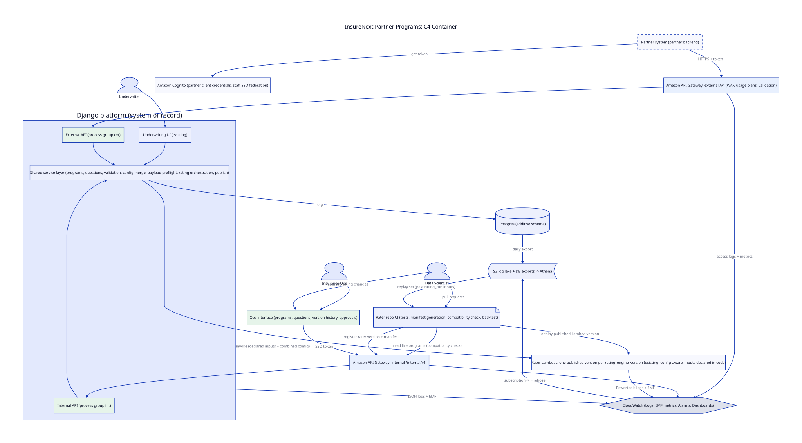
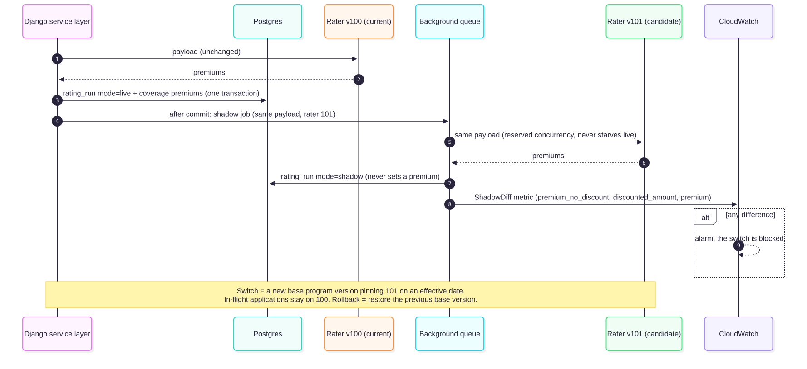

# Partner Programs on the InsureNext Platform

Dave Brazeau · November 2026

*AI-assisted with Claude.*

---

## TL;DR

We want to sell through partners, and every partner wants something slightly different: their own questions, adjusted rating, their own discounts. Today the only way to do that is an `if partner == ...` branch in the rater. That's how we got here, and it doesn't scale.

My proposal expands what's already there:

- Make a program a real, versioned thing in the data model, with full version history: publish, diff, restore.
- A program version picks its questions (as rows) and carries a small rating and discount config.
- Change the rater in two small, separate steps. First it declares its inputs in one place, with no pricing change. Later it reads the program's config. A partner that only customizes questions needs just the first step.
- Partners integrate through an external API that publishes each program's data contract: keys, types and allowed values. Anything else is rejected at the door.
- No hard cutover. New rater versions run in shadow next to the current one until they match to the cent, and the new partner API runs next to the existing integrations until those are retired.

If you only read four sections, read these:

- section 3: the data model, especially questions and version history
- section 4: how a program gets rated
- section 7: how bad or missing data is stopped before it reaches the rater
- section 9: how we get there without a cutover

---

## 1. What I heard

I boiled the stakeholder notes down to five problems.

| Problem | Raised by | What fixes it |
|---|---|---|
| Partner customizations are hardcoded in the rater | PM, Partner Growth | Programs as versioned config. The rater reads config and never checks which partner is asking. |
| Question keys are typed in two places and drift | PM | The rater declares its inputs once, in code. Questions, configs and partner schemas are generated from that declaration or checked against it by machine. |
| Ops can't change questions or simple rates without an engineer | Ops | An Ops interface with validation, preview, version history and approval |
| A rating change means a spreadsheet, an engineer, and a 1,000-application review meeting | Data Science | DS change the rater directly, and an automated backtest does the 1,000-application comparison for them |
| API partners send very little, and what they send is junk | PM | A published data contract per program, strict validation with field-level errors, and per-partner data-quality tracking |

---

## 2. Assumptions

The case study leaves a lot open, so these are the calls I made. I would confirm them with the right stakeholders before any final review or implementation.

1. Volumes are B2B insurance sized: likely thousands of applications a day at most. Nothing here needs exotic infrastructure.
2. Partners and insureds are US-only. From what I found, US insurance rules care about security and regulator access, not where the data physically sits, so one US AWS region is fine.
3. The raters are deterministic and don't call outside services mid-rating. If they do, those results become inputs to the rating instead.
4. Ops are allowed to change rates directly. If the products are admitted (state-filed rates), the same workflow works, but each change needs a filing reference and an approved effective date.
5. Program versions are selected the same way rater versions are today. Django already picks a rater version by effective date and stores it on the application. Program versions use the same rule and the same date, and the application stores its program version next to its rater version. Since the program version pins the rater, the two can't disagree.
6. Discounts keep stacking the way the current rater does it. The sample doesn't reconcile, would need to confirm with DS if it should be additive or compounded.

---

## 3. Data model



Everything is additive: new tables and new nullable columns. No existing column changes meaning, and no existing data gets rewritten.

### New tables

| Table | PK | Foreign keys | Why it exists |
|---|---|---|---|
| `partner` | `id` | none | Who we distribute through |
| `api_client` | `id` | `partner_id → partner` | A partner's API credentials (Cognito client) and throttling tier |
| `program` | `id` | `partner_id → partner` (null for the base program), `base_program_id → program` | A sellable offering. The base program is today's behavior. Partner programs derive from it. |
| `program_version` | `id` | `program_id → program`, `rating_engine_version_id → rating_engine_version`, `base_program_version_id → program_version`, `based_on_version_id → program_version` | One numbered version of a program. Drafts are editable, published versions never change. |
| `program_version_question` | `id` | `(program_version_id, rating_engine_version_id) → program_version`, `(question_id, rating_engine_version_id) → application_question` | Which questions a version asks, with the exact wording shown, order, and which ones are preset. The two composite FKs mean a program version can only use questions that belong to its own rater version. |
| `rating_run` | `id` | `application_id`, `program_version_id`, `rating_engine_version_id` | The exact request and response of every rating call |
| `application_discount` | `id` | `application_coverage_id → application_coverage` | Discounts per coverage. Today they're stored per application, which is ambiguous with more than one coverage. |
| `rating_test_case` | `id` | `program_id → program` (null means all programs) | Hand-written example applications with expected premiums, for segments that have no history yet |
| `backtest_run` | `id` | `program_version_id`, `rating_engine_version_id` | The impact report attached to every change |
| `idempotency_key` | `(api_client_id, key)` | `api_client_id → api_client` | Lets partners retry safely |

### Changes to existing tables

| Table | Change |
|---|---|
| `application` | Add `program_version_id` (FK, not null after backfill), `partner_id`, `channel`, `external_ref` (the partner's own id), `public_id`, `row_version`. `rating_engine_version_id` stays. A composite FK `(program_version_id, rating_engine_version_id) → program_version(id, rating_engine_version_id)` guarantees the application's rater is the one its program version pins, so existing code that reads the rater from the application keeps working. |
| `application_question` | Stays scoped to a rater version exactly as today. Add `answer_type`, `options` (code and label pairs), `validation` (min, max, pattern), `purpose`, and a unique `(rating_engine_version_id, rating_engine_question_key)`: one definition of each key per rater version. Rows become immutable once anything references them. |
| `application_answer` | Add `source` (applicant, partner API, preset, underwriter) and a unique `(application_id, question_id)`, so each answer is stored once and updated in place |
| `application_coverage` | Add `rating_run_id` (FK), so every premium points at the run that produced it |
| `rating_engine_version` | Add `manifest` (what the rater reads, generated from its code), `status`, `code_ref`. Versions from before the input declaration (section 9) have no manifest. They keep rating their own applications and stay replayable, but no partner program can pin them. |

### Questions

Questions are the part that grows, so they're modeled as rows with real foreign keys rather than inside a JSON blob. They're also the part an insurer has to be able to reproduce exactly. An application form is a filed document with an edition date, and changing its wording means a new edition. So questions are never edited, only superseded.

Key Points:

- Questions are immutable once used, need to change a question - create new one.
- Questions are tied to rater version, rater version uses exact question/"version of question"
- Base program contains its base questions, partner programs customize. Omit, preset, reorder, etc
- Fast experimentng, testing and deploying changes. Slowest chain is human approval process
- Only allowed values/answers are accepted. Keys don't change, labels can
- Eliminates junk data, errors
- Answers inherit the same protections by design
- Answers are 1 row per question and application

A question has two halves, and they're versioned with different things:

- **What the answer means** (`application_question`): key, type, and allowed value codes. This is what the rater interprets, so it stays scoped to a rater version, as it is today. "That exact question on that exact rater version" is the unique key. A row is never updated once anything references it, so nothing that happens later can reach back into a past application or rater.
- **How it's asked** (`program_version_question`): the exact wording, help text, option labels, order, required flag and show-if condition, plus which questions are asked or preset. This belongs to the program version, so rewording a question is a new program version. The old wording stays on the old version, attached to every application that saw it.

**How the tables fit together.**



- `application_question` is the store of immutable definitions. Every question that has ever existed lives here, one row per key per rater version. You can think of each rater version's rows as one edition of the application form.
- `program_version_question` is the link between a program version and the definitions it uses. It also holds what's specific to that version: wording, order, required, and ask, preset or omit. Once the version is published, these rows are frozen too.
- `program_version.rating_engine_version_id` is the single source of truth for which rater, and therefore which edition of definitions, a program version uses.
- `application_answer.question_id` points at the definition. That's what fixes the meaning of an answer forever. The wording the applicant saw is reached through the application's program version.

**Same question, different wording per partner.** One partner asks "How many kids do you have?" and another asks "How many children do you have?" To the rater it's the same input and it's weighed the same way. That works because the rater never sees the wording:

| | Partner A | Partner B |
|---|---|---|
| Wording (`program_version_question`) | "How many kids do you have?" | "How many children do you have?" |
| Definition (`application_question`) | The same row: key `num_children`, integer 0–20 | The same row |
| What the rater receives | `{"num_children": 3}` | `{"num_children": 3}` |

This is also why the unique `(rating_engine_version_id, rating_engine_question_key)` doesn't get in the way. There's one definition per key per rater version, and any number of wordings point at it. If the wording lived on `application_question`, that unique key would block the second partner. That's the reason the two halves are split.

The link from wording to meaning is the `question_id` on the `program_version_question` row. Ops create it when they pick `num_children` from the manifest's list of inputs and type the partner's wording. Nothing is inferred from the text.

Wording and weights are separate too. The weight lives in the rater, in a table keyed by input and value, for example `household_factor` with the dimension `num_children`, and the manifest lists it. A partner who wants the same question weighed differently gets a rate-table override in its config. The question doesn't change. Both are joined by the same key.

What a partner program can vary per question:

| Partner wants | How | Rater change? |
|---|---|---|
| Different wording, help text or option labels | `program_version_question` | No |
| Fewer allowed values, or a tighter range | Narrow the options on `program_version_question` (never widen) | No |
| Not to ask it | Preset the answer | No |
| A different weight | Rate-table override in config | No |
| A different answer shape (income bands instead of a number) | That's a different input. DS declare it, or add a module that maps one to the other. Until then it's an underwriting question. | Yes |

`rating_engine_version_id` appears in several tables. I checked each one, and every copy has a distinct job:

| Table | Role | Needed? |
|---|---|---|
| `application_question` | Owner: which edition a definition belongs to | Yes, existing column |
| `program_version` | The pin, the source of truth | Yes |
| `program_version_question` | Not new information. It exists so two composite FKs can make the database refuse a question from a different rater's edition. It can't drift, because both FKs force it to equal the program version's rater. | Yes, as a constraint. The alternative is a trigger, which is harder to see and easier to bypass. |
| `application` | Existing column that current Django code reads. A composite FK forces it to equal the program version's rater. | Keep for compatibility. Could be dropped once all code reads through the program version. |
| `rating_run` | Historical fact: what actually ran. A log must not depend on pointers that can change, such as a draft's rater or an application that was deliberately moved to a newer version. | Yes |
| `backtest_run` | The rater under test, which often has no program version yet (a DS pull request) | Yes |

Answers get the same protection without adding a column to that table: a trigger rejects an answer whose question belongs to a different rater version than the application.

The base program lists its full question set. A partner program lists only its differences: omit a question, preset it, reword it, require it, reorder it, or add a question only that partner asks. Anything it doesn't list comes from the base.

**When a new rater version is registered,** its question definitions are generated automatically from the previous version's rows and the new manifest. A definition that's unchanged is copied. One whose type or values changed is created from the manifest and flagged for Ops to check the wording. A rating input the new rater no longer reads simply isn't copied into the new edition. Underwriting and informational definitions are copied as they are. Copies are new rows, and the old rows are untouched. When a program moves to the new rater, its question set is re-pointed to the copies by key, also automatically. Nobody re-creates questions by hand.

**Nothing old is ever removed.** Every rater version, its definitions, and every program version pinned to it stay exactly as they were. An application quoted three months ago on rater 100 is replayed on rater 100, with its stored payload, and gives the identical premium. That's the core insurance requirement: a premium must be reproducible and explainable for as long as records are retained. A new rater version only affects programs that are deliberately moved onto it. Moving a program is a new program version, and publish refuses it if the program uses an input, value or module the new rater doesn't have. The old version keeps running untouched until that's resolved.

**Answers** stay one row per application and question. Ten questions or five hundred is the same shape and the same queries. Analysis across rater versions joins on the key, which is identical in every version.

Every question can change the outcome, either the price or the underwriting decision, so every question goes through the same versioning, validation and approval. They differ in who can add them, which the `purpose` column records:

| Purpose | Example | Read by | Who can add it |
|---|---|---|---|
| Rating input | industry, revenue, employee count | The rater | Data Science declares it in the rater. Ops then picks it from a list. |
| Underwriting | prior claims description | Underwriters and referral rules | Ops, directly, as a new definition under the program's current rater version |
| Informational | how did you hear about us | Reporting | Ops, directly, the same way |

This is what makes fast question experiments possible. Ops can add an underwriting or informational question and publish it the same day, with no rater change and no backtest. If the data proves predictive, Data Science declares that key as an input in the next rater version. The definition is carried forward as a rating input under the same key, and every answer collected so far is immediately usable.

On allowed values: for anything the rater reads, a closed list isn't an assumption, it's required. A deterministic rater has to know what to do with every value it can receive, so the list already exists in the code. Today it's implicit, often a silent `else` default. The refactor makes it explicit. Values are codes like `pest_control`, and the label shown lives on the program version, so Ops can reword "Pest Control" in a new version without touching the definition. Numbers get a type and a range instead of a list. Free text that the rater never reads has no list.

### Presets

Key Points

- Every application has a program, base program is the default
- Presets tailor the program and eliminate redundancy
- Required questions are answered or preset

The case study's own example, dropping industry questions for a restaurant program, breaks rating if done naively. The rater still needs `industry` to pick a class factor. If the program simply hides the question, the rater gets no value and either errors or quietly applies a default. A preset says "don't ask, we already know": the restaurant program presets `industry = restaurant`. The answer is written as a real answer row marked `preset`, so the rater and the record both see it.

There's no case where an application has no program. Direct business runs under the base program, every existing application is linked to it during the migration, and `program_version_id` becomes not null. Publishing checks that every input the rater requires is covered, by a required question or a preset, in every program version.

### Rating and discount config

Rate-table overrides and discounts are parameters for the rater, and the rater's manifest defines their shape. They're small, always read together, and never referenced by other rows, so they live in one JSON column on `program_version`:

```json
{
  "rating": {
    "table_overrides": { "class_factor": [ { "key": { "industry": "restaurant" }, "value": "0.92" } ] },
    "modules": [ { "name": "liquor_sales_surcharge", "params": { "rate": "0.05" } } ]
  },
  "discounts": {
    "underwriter_limits": { "schedule_credit": { "max": "0.15" } },
    "program": [ { "code": "member_discount", "coverages": ["epl"], "value": "0.05" } ]
  }
}
```

A program version's customizations are its question rows plus these two sections. Anything it leaves out behaves like the base. So "any combination" needs no feature flags: a restaurant program that only changes questions has question rows and an empty config.

### Discounts: what changes and what doesn't

Today, underwriter discounts are questions (`is_pricing_modifier`) answered once per application, and the payload sends them per coverage as `underwriter_discounts`. The rater applies them. The goal is that nothing an underwriter does, and no premium, changes unless a program opts in.

| | Today | After | Why nothing changes |
|---|---|---|---|
| How underwriters apply discounts | In the underwriting UI | The same, with the option to apply one to a single coverage | The base program's discount config is empty, so the limits are the rater's own |
| Stored as | Answers on the application | Old applications: unchanged, nothing migrated. New applications: `application_discount`, one row per coverage. | Django keeps both readers, and the payload builder chooses by which storage the application has |
| `underwriter_discounts` in the payload | Same keys and values on each coverage | Byte-identical | A phase 0 contract test builds the payload both ways for the replay set and compares them |
| Stacking math | In the rater | In the rater, untouched | We don't port or rewrite it. The sample doesn't reconcile, so DS confirm the rule before anyone touches it. |
| Program discounts | None | A separate, optional `program_discounts` field on each coverage | A payload without it is today's payload. The rater stacks program discounts through its existing rule. |
| Partner limits | None | A program can only lower an underwriter discount's maximum, never raise it | Validated at publish against the manifest |

The parity rule (section 6) covers discounts explicitly: `premium_no_discount`, `discounted_amount` and `premium` must all match to the cent, not just the final premium.

### Version history

Program changes work like Confluence pages:

- Each program has one open draft. It autosaves, and editing it never touches a published version.
- Publishing creates the next numbered version, with author, approver, change note, timestamp and effective date.
- The history shows every version. Any two can be diffed side by side: questions added, removed or changed, rate values, modules, discounts.
- "Restore version 7" creates a new draft with version 7's content. It goes through the same checks and approval, and publishes as, say, version 12. History is never rewritten.

In insurance, a premium quoted last March has to be explainable next year, so published versions are enforced as immutable at several levels:

- The service layer only edits drafts.
- A Postgres trigger rejects updates and deletes on published `program_version` rows and their question rows, except closing the effective window.
- An exclusion constraint stops two published versions of the same program from overlapping in time.
- A trigger rejects updates and deletes on any `application_question` row that a published version or an answer references. Wording changes go through a new program version, and meaning changes through a new rater version.
- Raters are referenced by published Lambda version numbers, never `$LATEST`. A moving alias would quietly rewrite history.

On top of that, `rating_run` stores the exact payload. The same payload on the same rater version always gives the same premium, so any past rating can be re-run. Today only the output is kept, and the answers may have been edited since, so there's nothing to re-run.

### The manifest ends double entry

Today a question key is typed into the question system and typed again in the rater code. Nothing checks that they match.

Instead, the rater declares its inputs once, in its own code: each key, its type, its allowed values, and whether it's required. The rater reads answers only through that declaration, so it can't use a key it hasn't declared. The build generates a manifest from the declaration, and the manifest is registered with the rater version. It lists:

- the inputs it reads, with types and allowed values
- the rate tables that may be overridden, and their limits
- the modules it has, their parameters, and the inputs each one needs
- its discount rules

Everything else is derived from the manifest or checked against it by machine. The Ops interface offers rating-input keys from it as a dropdown. Program versions are validated against it at publish. Django checks every payload against it before calling the rater. Nobody types a key a second time.

---

## 4. How a program gets rated

1. A partner or underwriter creates an application under a program. We resolve the program version in effect and store it on the application, together with the rater version it pins.
2. Preset answers are written as answer rows, marked `preset`.
3. Answers arrive from our UI or the partner's API calls. Each one is validated as it's written: right key, right type, an allowed value.
4. On submit, we check completeness against the program version. Every required question that's visible has an answer.
5. Django builds the rater payload: the answers the rater declares (nothing else), the coverages, the discounts, and the program's combined config.
6. Before calling the rater, Django validates the payload against the manifest. A gap here means a bug in an earlier check: rating stops with a clear error and an alarm instead of a wrong price.
7. The rater applies the overrides, runs any modules the config switched on, applies discounts, and returns premiums.
8. The request and response go into `rating_run` in the same transaction that updates the coverage premiums.

**Combining base and partner config.** A partner program's config only describes its differences from the base, so our Django service layer combines them before rating. That's a small merge function we write, not something the Django framework provides. Each section is combined so that a partner changes only what it names:

- Rate tables are combined row by row. If the base `class_factor` table has 40 rows and the partner overrides `restaurant`, the rater gets the base table with that one row replaced.
- Modules are combined by name. The partner can switch one on, change its parameters, or switch off one the base uses.
- Discounts are combined by code, the same way.

**What a module is.** A module is a function that already lives in the rater code and ships with the rater Lambda, for example `liquor_sales_surcharge`. Config can't add code. It can only switch on a module the deployed rater already has, which the manifest lists, and pass it parameters. That replaces `if partner == "acme"`. The program decides to use the logic, and the code never checks who's asking.

A module isn't a separate Lambda. It runs in-process inside the rater Lambda. The rater's entry point already acts as the controller: it reads `rating_config` from the payload, looks up each enabled module in its registry, and calls it at its point in the calculation, for example after base factors and before discounts. The manifest isn't read at runtime. It's a description generated at build time, used to validate configs before they're published. Keeping modules in-process means a rater version is one immutable artifact, which is what makes old ratings replayable. Each module as its own Lambda would add network calls and partial failures, and every rater version would have to pin an exact version of every module Lambda it calls. A rating that genuinely needs its own deployable gets its own rater version instead (the last row below).


This needs two separate changes to the rater (section 9). Step 6 only needs the first: the rater declares its inputs, which generates the manifest. Step 7 needs the second: reading overrides from the payload and a small module registry. Until a program uses rating or discount config, the payload is today's payload.

| Customization | Needs code? |
|---|---|
| Change a rate-table value within its limits | No |
| Reuse an existing module with different parameters | No |
| New logic | Yes, once, written as a module |
| Completely different rating | A separate rater version that the program pins |

Most partner requests should land in the first two rows.

The partner branches already hardcoded in the rater get converted into partner programs one at a time. For each one, the backtest has to show that partner's historical applications rate identically through the new program before the branch is deleted.

---

## 5. APIs



Two surfaces, one standard, one codebase.

- External API (`/v1`): partners and partner-built UIs. Cognito client credentials, per-partner throttling through API Gateway usage plans, and a partner only ever sees its own data.
- Internal API (`/internal/v1`): the Ops interface, the underwriting UI, and future internal services. Staff sign in with SSO.

Both are thin layers over the same Django service layer, so business rules exist exactly once. Both sit behind Amazon API Gateway, which is AWS's managed gateway, so there's no third-party product to run. I picked the REST type because it's the one with per-client usage plans and request validation.

The standard, briefly:

- OpenAPI first, linted in CI, with breaking changes blocked automatically
- RFC 9457 errors that point at the exact bad field
- cursor pagination
- `If-Match` on every edit, so two people can't silently overwrite each other
- `Idempotency-Key` on creates
- opaque public IDs
- money as decimal strings

### The application schema: a data contract, not a form

The most important endpoint is this one:

```
GET /v1/programs/{program_id}/application-schema
```

It returns the program's questions as plain JSON Schema: each key, its type, its allowed values (code and label), whether it's required, and any show-if conditions. JSON Schema carries labels and help text, how the questions look is the partner's business.

That's also why it isn't restrictive. Partners customize at two levels:

- **What gets asked** is their program: which questions, which are preset, which discounts and rating changes. They agree it with us, Ops configures it, and the schema they receive is already tailored to it.
- **How it's asked** is entirely theirs: their own screens, order, steps and branding. They can also pre-fill answers from data they already hold, which is often the main reason partners want an API.

Key Points:

- JSON schema contains all the tailored data for partner
- No junk data, wrong/bad/unknown data is reject and all errors are returned once
- Idempotency on submisions so one application per submission

What they can't do is invent keys or values. That's the junk-data fix at the source. Junk happens when a partner guesses: free text "pest control svcs" where we expect a code, "1M" where we expect a number, a misspelled key. With the contract, partners map their data to our codes once, while integrating against the sandbox. After that, every request is checked against the same schema we use internally. Unknown fields are rejected, and every error comes back in one response that names the exact field. Junk can't be stored.

The partner flow never needs data sent twice. Create a draft, save answers as the user goes (`PATCH` stores each one once), call submit (no body), and fetch the quote. Retries are safe because of idempotency keys, and `external_ref` stops the same application being created twice.

### Not breaking partner integrations

There are two contracts, and each has its own protection:

- **The API itself** (endpoints, fields, statuses) is versioned in the URL. CI blocks any breaking change to `/v1`. The statuses partners see are a stable, simplified version of our internal ones, so changing internal workflow doesn't break them.
- **A program's questions** change through program versions. Every application stays on the version it started with, so a change never breaks an application in progress. At publish, the system compares the new schema with the live one. Additive changes, like a new optional question or a new label, go out normally. Breaking changes, like a new required question, a removed question, a removed option or a type change, need a future effective date that respects the partner's notice period. They appear in the sandbox immediately, and the partner is notified. A base program change never reaches a partner's schema without a published partner version.

---

## 6. Shipping changes safely

A change to questions or rates changes what customers are asked or what they pay, so each kind of change has one automated path to production:

| Change | Who | Path |
|---|---|---|
| Question wording, order, an underwriting or informational question | Ops | Edit in the Ops interface → automatic checks → preview → one approver → publish |
| A rate value, module parameter or discount | Ops | Edit → automatic checks → automatic backtest and impact report → approver (DS too if impact is over threshold) → publish on an effective date |
| Rating logic, tables or modules | Data Science | Pull request → CI: tests, generated manifest, compatibility report showing which programs can adopt it as-is, backtest posted on the PR → merge → deployed as a new rater version that charges nobody → adopted through a base program version, approved by the business |

The last step of the DS path is the business green light from their current workflow, now attached to an actual impact report.

**The backtest.** It replays real applications through the rater twice, once as things are and once with the proposed change, and reports the difference for each one: how many premiums moved, by how much, the biggest movers, and any new declines or errors. The replay set starts with Data Science's 1,000 applications. It grows on its own, because every live rating's exact input is stored in `rating_run`. DS can also upload expected premiums from their spreadsheet, and the harness compares them to the cent. That's the review meeting DS described, automated.

**The parity rule.** When we refactor the rater (making it read config, pulling factors out into tables, converting partner branches), the refactored rater with no program config must produce exactly the premiums the current rater produces for the base program today. Not close, exact. Intentional price changes aren't held to that rule. They produce a difference report that the business approves.

**Catching valid but wrong changes.** Say someone enters 0.80 instead of 0.90. It's within the table's limits, and the approver misses it. Most of the time this is caught automatically before publish:
- Every change has impact thresholds, for example any single premium moving more than 10%, or the program average moving more than 3%. Crossing a threshold flags the change and requires a Data Science approver.
- If the replay set has no applications for the affected segment, as with a brand-new program, the `rating_test_case` examples cover it. Without those, the change is flagged as untested.
- The premium-drift alarm per program is the last net, for live traffic that looks different from history.

**Base rate increases.** Rates go up across the board every year, even when a program hasn't changed. That usually means a base rate or rate-level factor changes in the base program. Partner programs are pinned to a base version, so the increase doesn't silently reprice anyone, but it shouldn't be manual busywork either. When a base version is approved, the system creates a rebase draft for every partner program on the old base. The partner's own overrides carry over, and where a partner overrode the same value the base changed, the conflict is flagged. Each draft is checked and backtested automatically. Programs marked `follow_base` (the default) are approved together with the base change and published on the same effective date. Programs marked `manual`, such as a contractual rate lock, go to the partner manager's queue instead.

**Rollback** is restoring the previous version as a new one.

---

## 7. Keeping bad data away from the rater

The rater should never be the place where we find out an input is missing. Each stage below blocks a class of problem before the next stage can see it.



| Stage | Check | Prevents |
|---|---|---|
| Rater build (CI) | The rater reads inputs only through its declaration, and the manifest is generated from it. CI reports which live programs could adopt the new version as-is and which use an input, value or module it no longer has. Nothing fails, since adoption is a separate, deliberate step. | Surprises when a program is moved to the new rater |
| Question definitions | Rating-input definitions are generated from the manifest at rater registration, with key, type and values copied by the system | Typos and type mismatches |
| Program publish | The pinned rater has every input, value and module the program uses. Every required rater input is covered by a required, always-visible question or a preset. Presets and allowed options are valid values. Overrides are within limits. Modules exist, and the inputs they need are asked. | A program that can't be rated |
| Answer write | Key exists in this program version, the value has the right type, and it's an allowed value | Junk data stored at all |
| Submit | All required, visible questions are answered | Incomplete applications reaching rating |
| Before the rater call | Payload validated against the manifest | Anything earlier checks missed |
| Rater | Validates its own input and returns a structured error, never a silent default | A wrong price |

If something still gets through, the failure is loud and nothing is invalidated. The application stays submitted, its quote shows `needs attention`, no premium is written, and an alarm pages someone, because it means an earlier check has a bug.

Two more rules protect data that already exists:
- If an answer changes after rating, the quote is marked stale and must be re-rated before it can be used.
- Rater versions are never deleted. They can be closed to new programs, but stay callable for replay for as long as records are retained.

---

## 8. Observability

Everything here is AWS-native or an open-source library, and needs no new vendor.

- One JSON log schema across services: structlog in Django, Lambda Powertools in the raters. Every line carries the event name, request id, partner, program and application.
- Metrics come out of those same log lines via CloudWatch's embedded metric format. No separate metrics pipeline.
- CloudWatch alarms cover the things that actually hurt:
  - API 5xx errors and latency
  - rater errors and throttling, rolled into one "rating degraded" page
  - any failed pre-rating payload check, which should never happen
  - validation spikes per partner
  - partners who go silent
  - premium drift per program
  - database health
- Logs flow CloudWatch → Firehose → S3, queried with Athena once they're older than 30 days.
- Business numbers like submissions and quotes come from a daily Postgres export, not from logs. Logs can drop or duplicate events.

---

## 9. Transition and rollout

No hard cutover. The old path and the new one run side by side, and traffic moves over behind the scenes once the new one has proven it gives identical results. There are two places where that happens, and both use mechanisms that already exist or that we're adding anyway.

**Rating: the rater version is the switch.** Django already picks a rater version by effective date, and programs keep that rule. A changed rater ships as a new rater version, say 101, next to the current 100. It goes through three steps:

1. **Shadow.** Django rates with 100 as it does today, and that result is the one that's used. After the transaction commits, it sends the same payload to 101 in the background and stores the result as a `rating_run` with `mode = shadow`. Shadow results never set a premium. Any difference raises a metric and an alarm.
2. **Prove.** The replay set must match to the cent, and so must a period of live traffic, two weeks by default.
3. **Switch.** A new base program version pins 101 on an effective date. Applications already in flight stay on 100. Rollback means restoring the previous base version, which pins 100 again. Version 100 is never removed.



**Partners: the API Gateway is the switch.** The new `/v1` partner API is built behind API Gateway. Existing partner integrations keep running on their current endpoints, untouched. Each partner moves when its program is published and it has passed the sandbox. The old endpoints are retired after the deprecation window, and per-endpoint traffic tells us when they're empty. I wouldn't put the rater behind the gateway: Django-to-Lambda is internal, and the gateway would add a network hop and a 29-second timeout for nothing.

**The rater changes in two steps, and the first partner only needs the first.**

| Step | What changes in the rater | Pricing change | Needed for |
|---|---|---|---|
| 3a. Input declaration | One list of inputs (key, type, allowed values, required). The rater reads answers only through it, and the build generates the manifest from it. | None, proven by shadow and replay | Every partner program, including ones that only customize questions, presets or labels |
| 3b. Config-aware | Reads table overrides from the payload, and gets a module registry | None with an empty config, proven the same way | Only rating and discount customizations |

A partner program can only pin a rater version that has a generated manifest, so 3a is the one rater change on the path to the first partner. It's small and mechanical, it doesn't change pricing, and it's proven by the same harness. Per the case study, engineers already implement rater changes from the DS spreadsheet, so this lands with engineering and DS review the parity report. 3b runs as a second track, scheduled by what partners actually ask for. The existing hardcoded partner branches keep working throughout, because the payload they key on doesn't change. They're converted one at a time once 3b exists.

| Track | Phase | What ships | Done when |
|---|---|---|---|
| A | 0 | Safety net: tests that record today's premiums on the replay set and fail CI if any change, contract tests for the Django-to-rater payload (including discounts) and existing underwriting flows; logging and alarms; start storing `rating_run`, with shadow mode | No change can reach production without passing the premium tests; we have real volume and latency numbers |
| A | 1 | Partner and program tables; every existing application linked to a base program version | Nothing behaves differently |
| A | 2 | API standard, API Gateway, Cognito, internal API | Contract tests pass in CI |
| A | 3a | Rater input declaration, generated manifest, the pre-rating payload check | Shadow and replay match to the cent; the base program pins the new rater version |
| A | 4 | Question definitions carried forward per rater version, program question sets, presets, Ops interface with version history | Ops ship a question change with no engineer |
| A | 6 | External API, sandbox, one pilot partner (questions, presets, labels) | Pilot's data quality reviewed with the PM |
| B | 3b | Config-aware rater, backtest harness | An empty config matches today's premiums in shadow and replay |
| B | 3c | Convert the existing hardcoded partner branches | Each partner rates identically, and the branches are deleted |
| B | 5 | Per-coverage and program discounts, rebase drafts | Discounts rate correctly per coverage; a base change produces rebase drafts |

Track A is the shortest path to a live partner. Track B starts once phase 0 is in, runs alongside, and its features reach partners as program versions when they're ready.

Phase 0 goes first on purpose. Its tests are the parity rule every later phase is measured against, and every day we don't store rating requests is history we can't get back.

---

## 10. Trade-offs and what I left out

| I chose | Over | Because |
|---|---|---|
| Questions as rows, rating and discount parameters as JSON | Everything in JSON, or everything in tables | Questions are many, referenced by answers and edited often, so they need foreign keys. Rate parameters are small, shaped by the manifest, and read together. |
| Immutable question definitions per rater version, carried forward automatically | One shared, editable question library | An edit can never reach back into past applications or raters, which matches how filed forms work. The cost is copying rows on each rater release, which is automated. |
| Partner programs pinned to a base version, with automatic rebase drafts | Live inheritance of base changes | Nobody is repriced without a published version, but a yearly base increase still reaches every `follow_base` program in one approval |
| Config sent inline to the rater | The rater fetching config itself | Every payload is self-contained and replayable |
| Rater changed in two steps (declare inputs, then read config) | One rater refactor before any partner | The first partner depends on one small rater change with no pricing change, not on the whole refactor |
| Shadow run, then switch by effective date | A hard cutover | Every rater change is proven on live traffic before it charges anyone, and rollback is a normal publish. The cost is a second Lambda call per rating while a shadow runs. |
| API Gateway in front of everything | Just a load balancer | Partner limits, identity and logging in one place, and room for more services |
| One US region, multi-AZ, cross-region backups | Multi-region | No requirement for it, and recovery in hours is acceptable for now |

Deliberately left out of v1:

- Price A/B tests, meaning randomly quoting different prices to similar applicants to see which converts better. In admitted markets, rates must be filed and applied consistently, so this needs compliance approval first. Question and UX experiments are in scope.
- per-state rates
- program-specific coverages and limits
- commissions
- binding and payments
- webhooks (designed, not built)
- a partner portal where partners edit their own program
